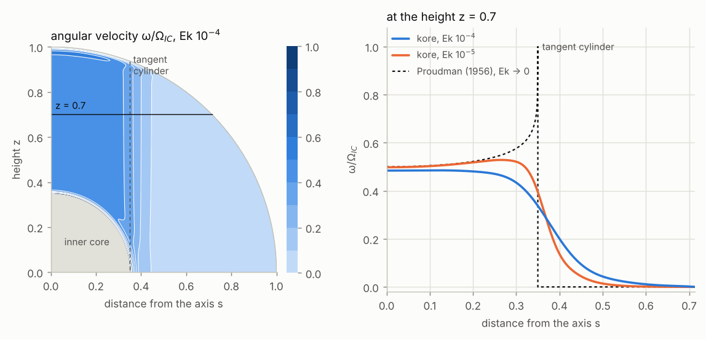

# Spherical Couette flow

Forcing 12 turns the walls steadily about the rotation axis, each at its own rate, and kore returns the steady flow
that they drive through the viscosity of the fluid: the spherical Couette flow. An inner core that turns a little faster
or slower than the mantle drives such a flow, as do the spheres of a spherical Couette experiment.

## What it imposes

The outer wall turns at `forcing_amplitude_cmb` and the inner wall at `forcing_amplitude_icb`, about the $z$ axis and
relative to the rotating frame, in units of $1/\tau$ (the rotation rate of the frame with `timescale = 'rotation'`). A
wall that turns must be no-slip (`bco` or `bci` = 1), so the fluid there turns with it:
$u_\phi = \Omega_w\thinspace r\sin\theta$, with $\Omega_w$ the rate of the wall. A wall at rest may also be
stress-free (`bco` or `bci` = 0): the fluid then slips along it, and only a drag holds it back
([Drag at the outer wall](drag.md)). Without one, an inner core that turns under a stress-free outer wall takes the whole
fluid with it in a rigid rotation. The equations are linear, so the flow is proportional to the rates: it is the limit
of small differences of rotation, whose flow is too weak to carry itself along.

The flow is steady, axisymmetric and equatorially symmetric, so the run needs `forcing_frequency = 0` (walls that turn
back and forth are the libration, forcing 7), `m = 0` and `symm = 1`, and a viscous fluid (`ViscosD > 0`). In a full
sphere (`ricb = 0`) only the outer wall can turn, and the fluid turns rigidly with it. With buoyancy (`thermal = 1`) the
run needs `ThermaD > 0`: without thermal diffusion nothing sets the steady entropy. Any `structure`, a differential
rotation and a field work as in the other runs. With `magnetic = 1` a conducting inner core or mantle turns with its
wall, and the field that the flow induces in the fluid and in the solids is solved with it
([Magnetic field](magnetic.md#forced-runs)).

## Example: an inner core that turns

Write in `bin/parameters.py`

```python
from params_default import default_params

par = default_params()

par.timescale = 'rotation'
par.Ek = 1e-4
par.set_scales()                  # Gaspard = 1, ViscosD = Ek

# incompressible fluid between an inner core and the mantle, no-slip walls
par.structure = 'Boussinesq'
par.ricb = 0.35
par.bci = 1
par.bco = 1

# axisymmetric and equatorially symmetric
par.m = 0
par.symm = 1

par.N = 96
par.lmax = 191
par.ncpus = 2

# the inner core turns steadily, the mantle with the frame
par.forcing = 12
par.forcing_frequency = 0.0
par.forcing_amplitude_icb = 1.0
par.forcing_amplitude_cmb = 0.0
```

and run

```shell
./bin/submatrices.py 2
mpiexec -n 2 ./bin/assemble.py
mpiexec -n 2 ./bin/solve.py
./bin/spin_doctor.py 2
```

It takes a few seconds.



The figure shows the angular velocity of the fluid, $\omega = u_\phi/s$, relative to the rate $\Omega_{IC}$ of the inner
core, in the northern hemisphere ($s$ is the distance from the axis). The rotation of the frame makes the flow nearly
the same all along the axis, so away from the walls the fluid turns in coaxial cylinders. Outside the tangent cylinder,
the cylinder that touches the equator of the inner core, each cylinder of fluid meets only the mantle, and turns with
it: here, not at all. Inside, each one is held between the thin viscous layers on the inner core and on the mantle
(the Ekman layers), which pull it towards their own rates, and it turns in between: at about half the rate of the inner
core near the axis, and faster towards the tangent cylinder. As Ek tends to 0 this is the solution of Proudman (1956),

$$
\frac{\omega}{\Omega_{IC}} = \frac{(1 - s^2)^{1/4}}{(1 - s^2)^{1/4} + (1 - s^2/r_i^2)^{1/4}}, \qquad s < r_i ,
$$

and $\omega = 0$ outside. A shear layer on the tangent cylinder, the Stewartson layer, spreads the jump between the two
regions, and it narrows as Ek decreases. Near the axis kore gives 0.484 at Ek $10^{-4}$ and 0.498 at Ek $10^{-5}$
(N 160, `lmax` 383), where the formula gives 0.5.

## Reading the output

The flow is in `real_flow.field`; the imaginary part is 0, since the flow is steady. For `m = 0` the angular velocity
is

$$
\omega = \frac{u_\phi}{r\sin\theta} = \frac{2}{r}\sum_l T_l(r)\thinspace P_l'(\cos\theta) ,
$$

with the toroidal scalars $T_l(r)$ of odd $l$, as on [Thermal forcing](thermal-forcing.md#reading-the-output).

`spin_doctor` checks the budgets. The turning walls put in P_in, the power of their viscous stress on the fluid, and the
viscous dissipation Dν uses it up, with the Ohmic losses when there is a field and the work against the buoyancy of a
stratified fluid (residσ, and resid𝐄 with a field). In `flow.dat`, columns 31 and 33 are the viscous torques on the
mantle and on the inner core, and 35 and 37 the magnetic ones ([Output files](output.md#flowdat)). P_in is minus the
sum of each rate times the viscous torque on its wall. In the steady state the torques on the two solids cancel: the
fluid passes the torque of the inner core on to the mantle, which resid𝐋 checks. Where the fluid turns rigidly (both
walls at one rate, a full sphere, an inner core under a stress-free outer wall at rest), nothing is sheared and every
term of the budgets is zero: the residuals then compare round-off with round-off, and can be near 1.

## Parameters

| parameter | meaning |
| --- | --- |
| `forcing` | 12 |
| `forcing_frequency` | 0 |
| `forcing_amplitude_cmb` | the rate of the outer wall, in units of $1/\tau$ |
| `forcing_amplitude_icb` | the rate of the inner wall (0 in a full sphere) |
| `m`, `symm` | 0, 1 |
| `bci`, `bco` | 1 for a wall that turns; 0 or 1 for a wall at rest |

The solution is written as for any forced run ([Output files](output.md)), and `tests/couette` checks it against the
`conductive_IC` branch, the exact flow without rotation and the rigid rotations, and checks its budgets
([Modifying kore](checking.md)). `bin/bgflow.py` turns the flow, linear or nonlinear, into the background of other runs,
whose waves and instabilities it carries ([Background flow](bgflow.md#a-background-from-turning-walls)).
