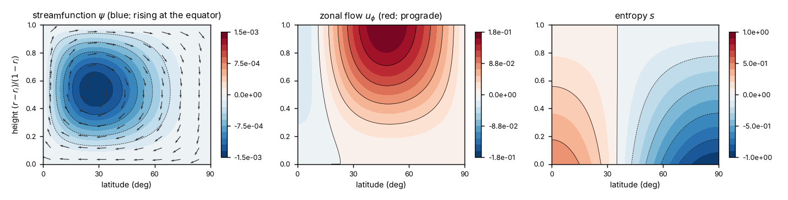

# Thermal forcing

Forcing 13 heats the inner wall unevenly in latitude, the way the Sun heats the ground of a planet more at the equator
than at the poles. kore returns the flow that this heating drives: an overturning circulation in the meridional plane,
like the Hadley cells of the Earth's atmosphere, together with the zonal winds that the Coriolis force makes of it.

## What it imposes

The entropy at the inner wall varies with latitude as

$$
s(r_i, \theta) = A\thinspace P_2(\cos\theta), \qquad P_2(\cos\theta) = \tfrac12 (3\cos^2\theta - 1),
$$

with $A$ = `forcing_amplitude_icb`. With `bci_thermal = 1` the same pattern is imposed on the heat flux instead. $P_2$
is $-\tfrac12$ at the equator and 1 at the poles, so a negative $A$ makes the equator warmer. The flow is proportional
to $A$.

Requirements:

- `m = 0` and `symm = 1` (the pattern is axisymmetric and symmetric about the equator);
- an inner core (`ricb > 0`), `thermal = 1` and `ThermaD > 0`.

With `forcing_frequency = 0` the solution is the steady flow. It then needs at least one no-slip wall (`bci = 1` or
`bco = 1`) or a drag at the outer wall ([Drag at the outer wall](drag.md)); otherwise a rigid rotation could be added
to any solution. Both walls must also stay in place (`bci` and `bco` 0 or 1). A non-zero `forcing_frequency` gives the response to a heating that oscillates in time.

The forcing also works with a magnetic field ([Magnetic field](magnetic.md#forced-runs)).
[Combining features](compatibility.md#forced-runs) lists what else it combines with.

## Example: a Hadley cell

Write in `bin/parameters.py`

```python
from params_default import default_params

par = default_params()

par.timescale = 'rotation'
par.Ek = 1e-3
par.Etherm = 1e-3
par.set_scales()                  # Gaspard = 1, ViscosD = Ek, ThermaD = Etherm

# Boussinesq fluid in a thin rotating shell, stably stratified
par.structure = 'Boussinesq'
par.stratification = 'inverse square'
par.thermal = 1
par.Beyonce = 10.0
par.ricb = 0.9
par.bci = 1                       # no-slip ground
par.bco = 0                       # stress-free top
par.bci_thermal = 0               # the entropy of the ground is imposed
par.bco_thermal = 0

# axisymmetric and equatorially symmetric
par.m = 0
par.symm = 1

par.N = 48
par.lmax = 47
par.ncpus = 2

# steady heating of the ground, the equator warmer than the poles
par.forcing = 13
par.forcing_frequency = 0.0
par.forcing_amplitude_icb = -1.0
```

and run

```shell
./bin/submatrices.py 2
mpiexec -n 2 ./bin/assemble.py
mpiexec -n 2 ./bin/solve.py
```

It takes a few seconds. The solution is in `flow.npy` and `thermal.npy` ([Output files](output.md#solution-files)).



The figure shows the northern hemisphere. The fluid rises over the warm equator, moves poleward aloft, sinks at high
latitudes and returns to the equator along the ground: one cell per hemisphere. The Coriolis force turns the poleward
flow aloft into a prograde (westerly) jet, and the return flow near the ground into retrograde (easterly) winds at low
latitudes. At higher latitudes the winds near the ground are prograde, because a steady flow exerts no net torque on
the ground.

A linear, axisymmetric flow has no eddies, so the cell reaches from the equator to the pole and there are no Ferrel
cells. At lower Ekman numbers the circulation retreats into the boundary layer at the ground and towards the equator.

## Reading the output

For `m = 0`, each field is a sum over Legendre polynomials $P_l(\cos\theta)$. With the poloidal and toroidal
coefficients $P_l(r)$, $T_l(r)$ and the entropy coefficients $s_l(r)$ of the solution ([Output files](output.md)), and
uniform density as in the example, the meridional streamfunction $\psi$, the zonal velocity and the entropy are

$$
\psi = -2\thinspace\mathrm{Re} \sum_l r\thinspace P_l(r) \sin\theta\thinspace \partial_\theta P_l(\cos\theta), \qquad
u_\phi = -2\thinspace\mathrm{Re} \sum_l T_l(r)\thinspace \partial_\theta P_l(\cos\theta), \qquad
s = 2\thinspace\mathrm{Re} \sum_l s_l(r)\thinspace P_l(\cos\theta).
$$

The streamfunction gives the meridional velocity, $u_r = \partial_\theta\psi/(r^2\sin\theta)$ and
$u_\theta = -\partial_r\psi/(r\sin\theta)$. In the northern hemisphere, negative $\psi$ is a cell that rises at the
equator.
