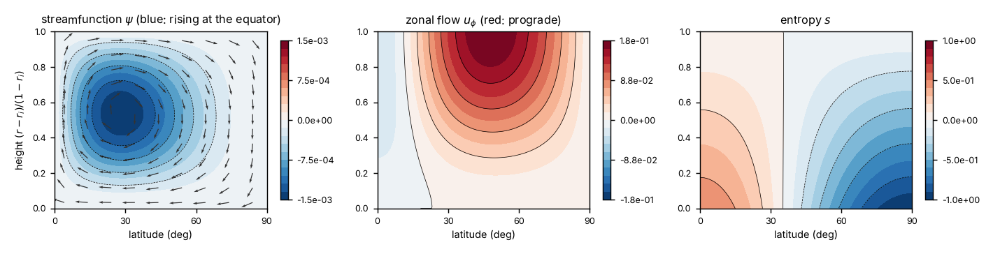

# Thermal forcing

Forcing 13 heats the inner wall unevenly in latitude, as the Sun heats the ground of a planet more at the equator
than at the poles. kore returns the flow that this heating drives: an overturning circulation in the meridional
plane, like the Hadley cells of the Earth's atmosphere, and the zonal winds that the Coriolis force makes of it.

## What it imposes

The entropy at the inner wall $r = r_i$ is

$$
s(r_i, \theta) = A\thinspace P_2(\cos\theta), \qquad P_2(\cos\theta) = \tfrac12 (3\cos^2\theta - 1),
$$

with $A$ = `forcing_amplitude_icb`. With `bci_thermal = 1` the condition is on the gradient instead,
$\partial_r s(r_i, \theta) = A\thinspace P_2(\cos\theta)$, a prescribed heat flux. $P_2$ is $-\tfrac12$ at the equator
and $1$ at the poles, so a negative $A$ makes the equator warmer. The pattern is axisymmetric and equatorially
symmetric, so the run needs `m = 0` and `symm = 1`, and also `ricb > 0`, `thermal = 1` and `ThermaD > 0`. The problem
is linear: the flow is proportional to $A$.

With `forcing_frequency = 0` the solution is the steady flow. At least one wall must then be no-slip (`bci = 1` or
`bco = 1`): with two stress-free walls a rigid rotation of the fluid also solves the equations, and the solution is
not unique. A non-zero `forcing_frequency` $w$ gives the response to a heating that oscillates as $e^{iwt}$.

## Example: a Hadley cell

Write in `bin/parameters.py`

```python
from params_default import default_params

par = default_params()

par.timescale = 'rotation'
par.Ek = 1e-3
par.Etherm = 1e-3
par.set_scales()                  # Gaspard = 1, ViscosD = Ek, ThermaD = Etherm

# Boussinesq fluid in a thin rotating shell, conductive and stably stratified: N² = Beyonce/r
par.structure = 'Boussinesq'
par.stratification = 'inverse square'
par.thermal = 1
par.Beyonce = 10.0
par.ricb = 0.9
par.bci = 1                       # no-slip ground
par.bco = 0                       # stress-free top
par.bci_thermal = 0               # the entropy of the ground is imposed
par.bco_thermal = 0

# axisymmetric and equatorially symmetric
par.m = 0
par.symm = 1

par.N = 48
par.lmax = 47
par.ncpus = 2

# steady heating of the ground, the equator warmer than the poles
par.forcing = 13
par.forcing_frequency = 0.0
par.forcing_amplitude_icb = -1.0
```

and run

```shell
./bin/submatrices.py 2
mpiexec -n 2 ./bin/assemble.py
mpiexec -n 2 ./bin/solve.py
```

It takes a few seconds. The solution is in `real_flow.field`, `imag_flow.field`, `real_thermal.field` and
`imag_thermal.field` ([Output files](output.md)).



The figure shows the northern hemisphere. The fluid rises over the warm equator, moves poleward aloft, sinks at high
latitudes and returns to the equator along the ground: one cell per hemisphere. The Coriolis force turns the
poleward flow aloft into a prograde (westerly) jet, and the return flow near the ground into retrograde (easterly)
winds at low latitudes. Poleward of about 25° the winds near the ground are prograde, because a steady flow exerts no
net torque on the ground.

A linear, axisymmetric flow has no eddies. As a result, the cell reaches from the equator to the pole, and there are no
Ferrel cells. At lower Ekman numbers the circulation retreats into the Ekman layer at the ground and towards the
equator. A stress-free top wall then also has a weak reversed cell above it.

## Reading the output

For `m = 0` each field is its coefficient times $P_l(\cos\theta)$, plus the complex conjugate. With the poloidal and
toroidal scalars $P_l(r)$, $T_l(r)$ and the entropy $s_l(r)$ (Chebyshev series in $r$ over $[r_i, 1]$, one block
of `N` coefficients per $l$; $l$ even for $P$ and $s$, odd for $T$), and with $\rho_0 = 1$ as in the example,

$$
\psi = -2\thinspace\mathrm{Re} \sum_l r\thinspace P_l(r) \sin\theta\thinspace \partial_\theta P_l(\cos\theta), \qquad
u_\phi = -2\thinspace\mathrm{Re} \sum_l T_l(r)\thinspace \partial_\theta P_l(\cos\theta), \qquad
s = 2\thinspace\mathrm{Re} \sum_l s_l(r)\thinspace P_l(\cos\theta),
$$

where the meridional streamfunction $\psi$ gives $u_r = \partial_\theta\psi/(r^2\sin\theta)$ and
$u_\theta = -\partial_r\psi/(r\sin\theta)$. In the northern hemisphere $\psi < 0$ is a cell that rises at the equator.
